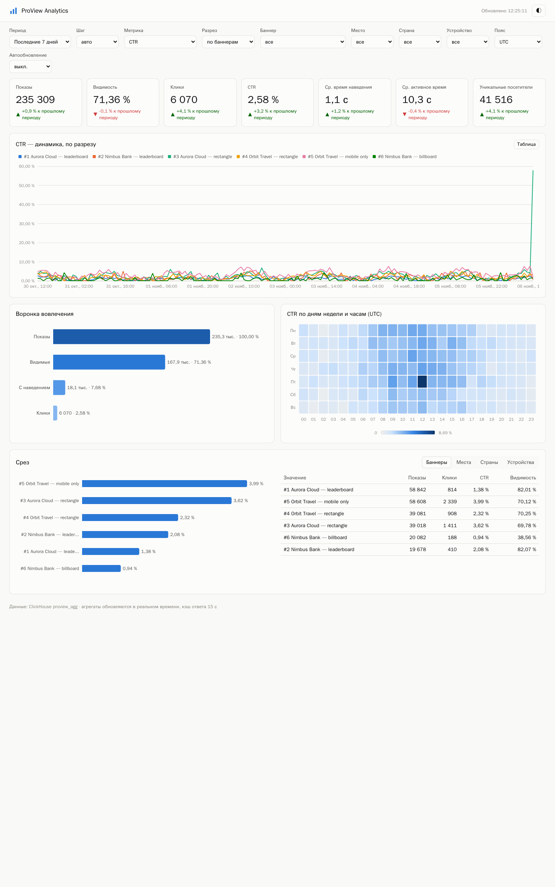

# proview-docs

Документация платформы **ProView** — показ рекламных баннеров с измерением вовлечённости (видимость, наведение, клик, активное время) на 20k RPS. Оформлена по [BMAD Method](https://github.com/bmad-code-org/BMAD-METHOD): артефакты аналитика, PM, архитектора, UX и QA, истории разработки. Конфигурация агентов — `.bmad-core/core-config.yaml`.

## Содержание

| Документ | Роль BMAD | Что внутри |
|---|---|---|
| [Project Brief](docs/brief.md) | Analyst | проблема, пользователи, цели, объём MVP, риски |
| [PRD](docs/prd.md) | PM | FR/NFR, эпики и истории |
| [Architecture](docs/architecture.md) | Architect | схемы C1/C2/C3 и последовательностей, данные и контракты, ёмкость на 20k RPS, отказоустойчивость, безопасность, наблюдаемость, стек |
| [ADR](docs/adr/README.md) | Architect | 19 решений: обоснование, альтернативы, последствия |
| [UI/UX Spec](docs/front-end-spec.md) | UX Expert | структура админки, правила визуализации, доступность, скриншоты |
| [Stories](docs/stories) | SM / Dev | 13 историй с критериями приёмки и ссылками на тесты |
| [Test Strategy](docs/qa/test-strategy.md) | QA | пирамида тестов, фактические результаты, найденные дефекты |
| [Install](docs/runbooks/install.md), [Operations](docs/runbooks/operations.md) | Ops | установка в Kubernetes, инциденты, ротация ключей |

## Репозитории

| | |
|---|---|
| [proview-banner-service](https://github.com/DemonIngvi/proview-banner-service) | выдача баннеров, API пула |
| [proview-event-collector](https://github.com/DemonIngvi/proview-event-collector) | приём событий → Kafka |
| [proview-event-ingester](https://github.com/DemonIngvi/proview-event-ingester) | Kafka → ClickHouse, агрегаты |
| [proview-analytics](https://github.com/DemonIngvi/proview-analytics) | API срезов и админка |
| [proview-web](https://github.com/DemonIngvi/proview-web) | демо-страница и SDK |
| [proview-deploy](https://github.com/DemonIngvi/proview-deploy) | compose, Helm, e2e, chaos, нагрузка |

HTML-версия с поиском, схемами, тёмной темой и автоматическими кросс-ссылками: `python tools/build_site.py` → `site/index.html` (нужен пакет `markdown`).

ADR и истории генерируются из `tools/adr_data.py` и `tools/gen_stories.py` (`python tools/gen_adr.py && python tools/gen_stories.py`). Правьте данные, а не сгенерированные файлы.

Лицензия: Apache-2.0.
