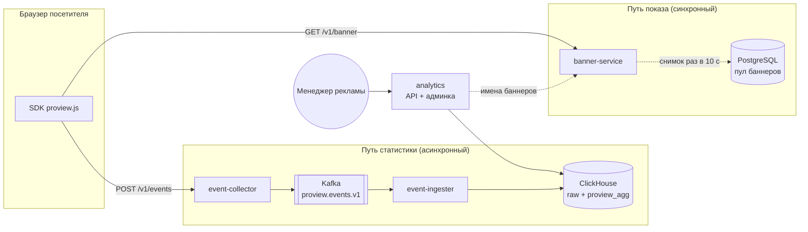
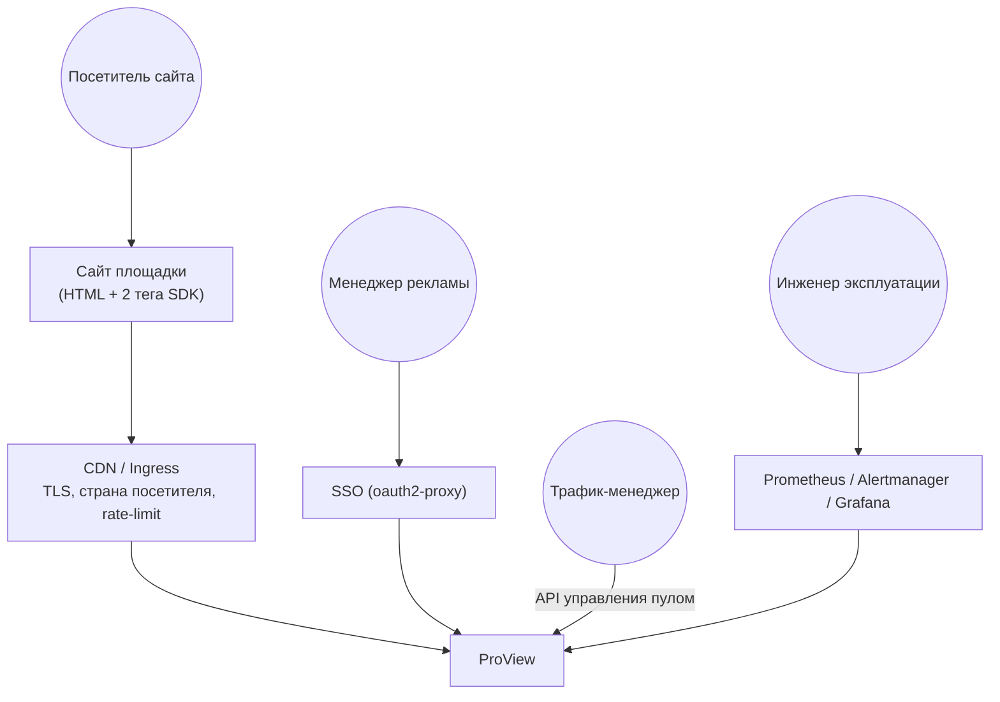
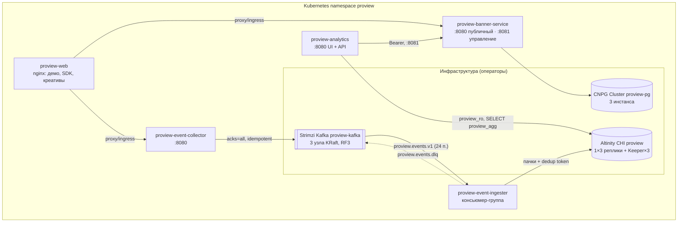
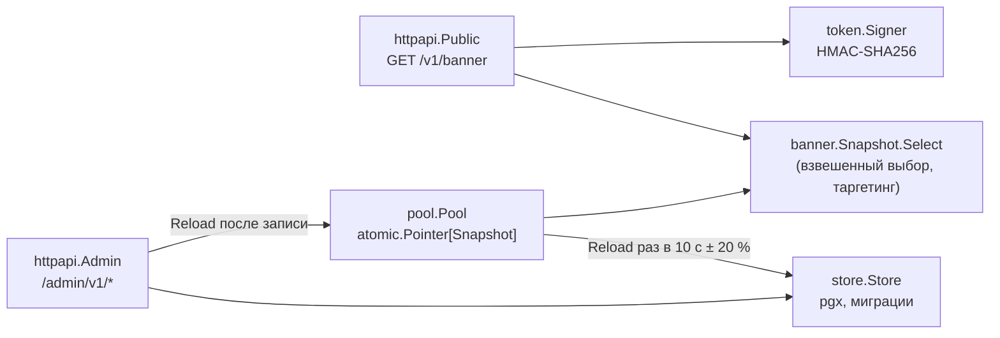
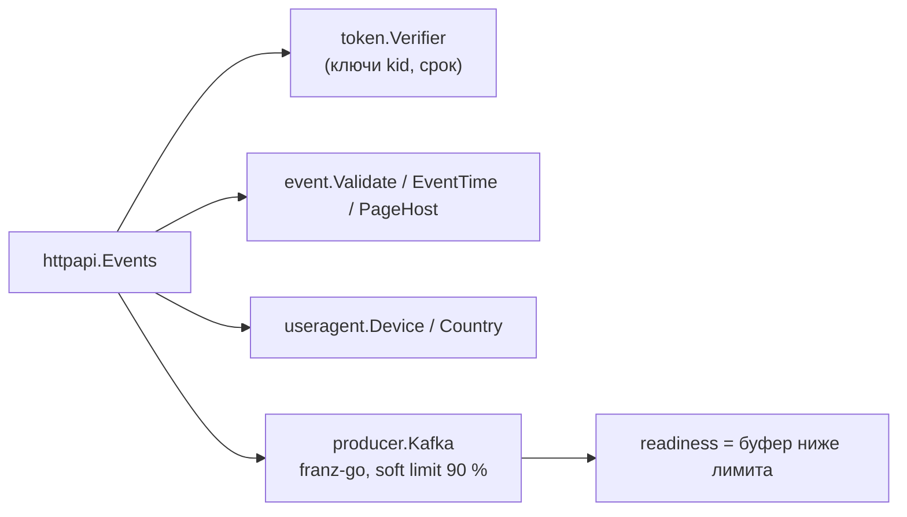
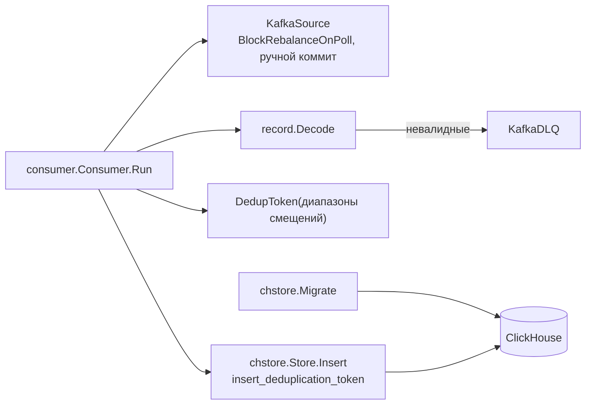
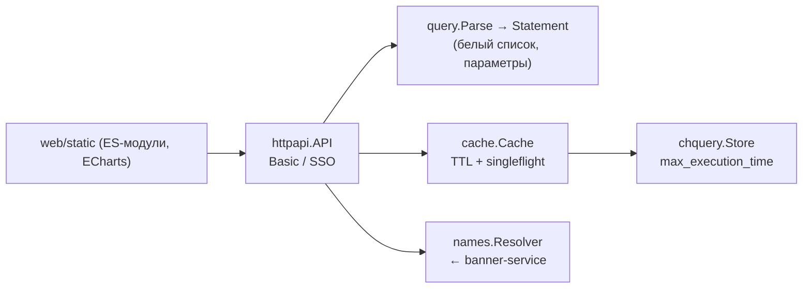
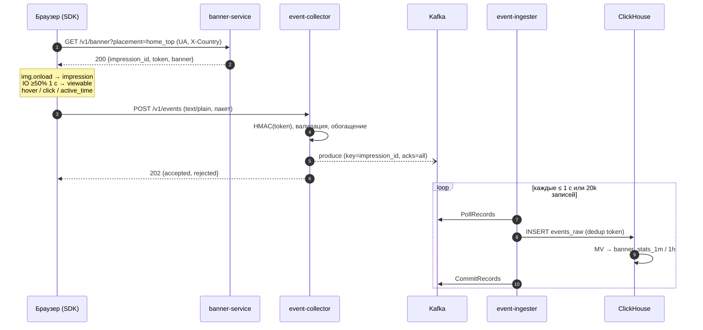
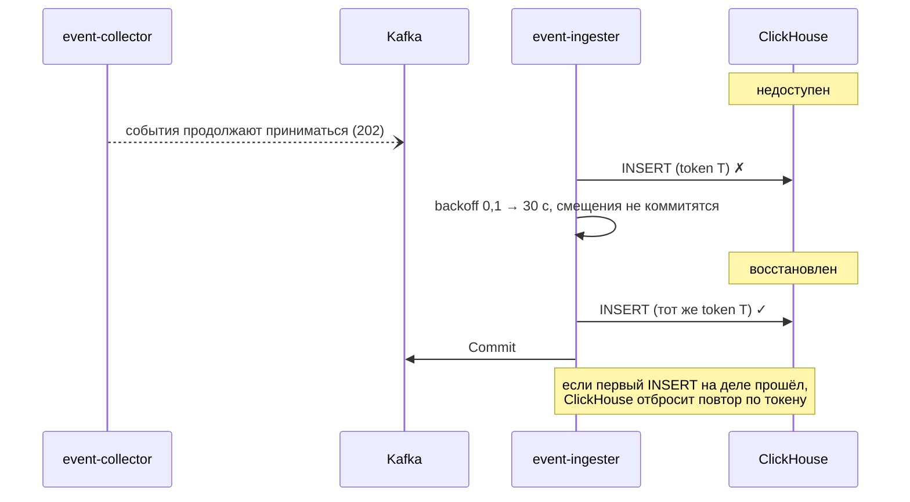

# ProView — Architecture Document

> BMAD Method · артефакт Architect · версия 1.0 · 2026-11-06 · основа: [prd.md](prd.md) · решения: [adr/](adr/README.md)

## 1. Обзор

ProView состоит из пяти stateless-сервисов и трёх систем хранения. Путь показа и путь статистики разделены. Выдача баннера не зависит от аналитики, приём событий не зависит от хранилища: между ними стоит Kafka как буфер и журнал повторного воспроизведения.

## 2. Контекст (C1)

| Внешняя система | Что даёт ProView | Что получает |
|---|---|---|
| Сайт площадки | места `data-proview-placement` | баннеры, SDK |
| CDN / Ingress | TLS, заголовок страны (`CF-IPCountry` / GeoIP), лимиты на IP | — |
| SSO | аутентификацию админки | — |
| Мониторинг | — | метрики `/metrics`, логи JSON |

## 3. Контейнеры (C2)

| Блок | Ответственность | Состояние | Масштабирование | Сильные стороны | Слабые стороны и компромиссы |
|---|---|---|---|---|---|
| banner-service | выбор баннера, токен показа, API пула | снимок пула в памяти | HPA по CPU, 4–30 подов | ~230 нс на выбор, не зависит от БД на горячем пути | изменения пула видны с задержкой до `REFRESH_INTERVAL` (10 с) |
| event-collector | приём, проверка, обогащение, публикация | буфер продюсера (ограничен) | HPA по CPU, 6–40 подов | ответ сразу после буфера, явный 503 при перегрузке | при падении пода теряется только не подтверждённый Kafka буфер (≤ linger + in-flight), ответ 202 к тому моменту уже ушёл |
| event-ingester | Kafka → ClickHouse, DLQ, схема | нет (смещения в Kafka) | KEDA по лагу, ≤ 24 подов (= партиций) | идемпотентные пачки, повторы до успеха | при длительной недоступности ClickHouse группу перебалансирует, возможен дубль последней пачки, если границы пачек сместились |
| analytics | API срезов, админка | кэш ответов 15 с | HPA, 2–6 подов | читает только агрегаты, параметризованный SQL | уникальные посетители приблизительные (HLL, ~1–2 %) |
| web | демо-страница, SDK, креативы | нет | HPA; в проде за CDN | нет сборки, нет зависимостей | демо-прокси нужен только без отдельных доменов API |
| Kafka | журнал событий, буфер на 3–7 дней | диски | +брокеры, +партиции | развязывает приём и хранение, позволяет повторное воспроизведение | операционная сложность (снимается Strimzi) |
| ClickHouse | сырые события, агрегаты | диски, Keeper | +реплики (чтение), +шарды (запись) | сотни тысяч строк/с на ядро, сжатие ×10 | не OLTP: точечные обновления дороги (не нужны) |
| PostgreSQL | пул баннеров (источник истины) | диски | реплики для failover | транзакции, ограничения схемы | на горячем пути не используется (так и задумано) |

## 4. Компоненты (C3)

### banner-service

### event-collector

### event-ingester

### analytics

## 5. Ключевые потоки

### 5.1 Показ и события

### 5.2 Отказ ClickHouse

### 5.3 Изменение пула

`POST /admin/v1/banners` → запись в Postgres → немедленная перезагрузка снимка на принявшем экземпляре → остальные реплики подхватывают изменение по таймеру (≤ 10 с + джиттер).

## 6. Данные и контракты

### 6.1 PostgreSQL (banner-service)

| Таблица | Ключевые поля |
|---|---|
| `placements` | `id` (slug), `width`, `height`, `description` |
| `banners` | `id`, `name`, `image_url`, `click_url`, `alt`, `width`, `height`, `weight 1..10000`, `active`, `starts_at`, `ends_at`, `placements[]`, `countries[]`, `devices[]` |

### 6.2 Токен показа (banner-service → SDK → collector)

`base64url("1|kid|impression_id|banner_id|placement|issued_unix") + "." + base64url(HMAC-SHA256(key)[:16])`. Проверка в collector: известный `kid`, подпись, `issued ≤ now + 1 мин`, возраст ≤ `TOKEN_MAX_AGE`. Ротация: новый ключ в `TOKEN_SECRET`/`TOKEN_KEY_ID`, старый остаётся в `TOKEN_KEYS` на срок жизни токена. Контрольный вектор зафиксирован тестами в обоих репозиториях.

### 6.3 Сообщение Kafka `proview.events.v1` (JSON, v=1)

| Поле | Тип | |
|---|---|---|
| `v` | int | версия схемы (1) |
| `event_id` | string | `impression_id:seq`, детерминирован |
| `type` | string | impression / viewable / hover / click / active_time |
| `impression_id`, `banner_id`, `placement` | | из токена (не от клиента) |
| `event_ts`, `received_ts` | int64 мс | клиентское время в пределах ±5 мин, иначе серверное |
| `duration_ms` | uint32 | hover / active_time |
| `visitor_id`, `country`, `device`, `page_host` | string | обогащение |

Ключ сообщения — `impression_id`. Правила эволюции: добавление полей не меняет версию. Несовместимое изменение — новый топик `v2` и параллельная работа обоих.

### 6.4 ClickHouse

| Объект | Движок | Порядок / партиция | TTL |
|---|---|---|---|
| `proview.events_raw` | MergeTree | `(banner_id, event_type, event_time)` / день | 30 дней |
| `proview_agg.banner_stats_1m` | AggregatingMergeTree | `(bucket, event_type, banner_id, placement, country, device)` / день | 14 дней |
| `proview_agg.banner_stats_1h` | то же | то же / месяц | 730 дней |
| `mv_banner_stats_1m/1h` | MV | `count()`, `sum(duration_ms)`, `uniqState(visitor_id)` | — |

### 6.5 Определения метрик

CTR = клики / показы; видимость = видимые / показы; доля наведений = наведения / показы; ср. наведение = Σ hover_ms / наведения; ср. активное время = Σ active_ms / показы; уникальные = `uniqMerge` по показам. Считаются на сервере (`query.Metrics.Derive`).

## 7. Ёмкость и масштабирование

Исходные допущения: 20 000 RPS = 10 000 просмотров/с × (1 `GET` + 1 `POST`). В среднем ~5 событий на просмотр (показ, видимость, активное время каждые 5 с, часть наведений и кликов), то есть **~50 000 событий/с**. Средняя суточная нагрузка — ~30 % пика.

| Компонент | Замер | Расчёт на пик | Рекомендация |
|---|---|---|---|
| banner-service | обработчик 3,5 мкс (бенчмарк), выбор 0,23 мкс | 10k RPS × ~50 мкс CPU (с net/http и TLS на ingress) ≈ 0,5 ядра | 4–6 подов по 1 ядру (запас ×8 и переживание отказа зоны) |
| event-collector | обработчик 9 мкс, HMAC 0,7 мкс | 10k RPS × ~100 мкс ≈ 1 ядро + клиент Kafka | 6–10 подов по 1 ядру |
| Kafka | — | 50k × ~300 Б ≈ 15 МБ/с JSON, после zstd ~4 МБ/с; ×RF3 = 12 МБ/с записи на кластер | 3 брокера; хранение 3 дня при пике ≈ 1 ТБ на брокер |
| event-ingester | 1,95 млн событий за 70 с на одном поде (стенд) | 50k/с ≈ 2 пода | 4 пода (до 24 по лагу) |
| ClickHouse | вставка пачками 5–20k строк | 50k строк/с — малая доля возможностей узла; raw ~35 Б/строка сжато ≈ 1,4 ТБ за 30 дней при средней 30 % | 3 реплики × 8 ядер / 32 ГБ / 2 ТБ NVMe |
| analytics | кэш 15 с, агрегаты | агрегаты в тысячи раз меньше raw | 2 пода |

Замер на одном хосте (весь стек и генератор нагрузки на 16 vCPU):

| Нагрузка | Ошибки | p95 | p99 | Примечание |
|---|---|---|---|---|
| ~6,8k RPS | 0 % | 0,9 мс | 3 мс | — |
| цель 20k, держит ~17k RPS | 0,005 % | 148 мс | — | упор в CPU хоста: Kafka 186 %, k6, nginx |

Горизонтальное масштабирование сервисов линейно: stateless, без общих блокировок. Пределы:
- ingester — число партиций (24, увеличивается без простоя);
- ClickHouse на запись — шардирование (переход на `Distributed` + шарды);
- Kafka — брокеры и партиции.

## 8. Надёжность и отказоустойчивость

| Отказ | Поведение | Потеря данных | Проверка |
|---|---|---|---|
| Postgres недоступен | выдача из последнего снимка, API пула 500 | нет | unit `pool` |
| Под banner-service | PDB, HPA, readiness; SDK скрывает место при ошибке | нет | — |
| Под collector (SIGTERM) | readiness false → дренаж 5 с → flush буфера | нет | graceful shutdown |
| Под collector (крах) | события в буфере, не подтверждённые Kafka, теряются; 202 к этому моменту уже отдан | ≤ ~10 мс трафика пода | компромисс ради латентности, [ADR-0008](adr/0008-delivery-semantics.md) |
| Брокер Kafka | RF 3, min ISR 2, лидерство переходит | нет | Strimzi |
| Перегрузка collector | 503 + Retry-After, SDK повторяет, readiness false | нет | unit, k6 |
| ClickHouse недоступен | события копятся в Kafka (дни), ingester повторяет | нет, ровно один раз | `chaos.sh` сценарий 1 |
| Крах ingester | пачка без коммита читается снова; токен отбрасывает дубль | нет | `chaos.sh` сценарий 2 |
| Битое сообщение | DLQ с причиной, поток не останавливается | нет (сохранено в DLQ) | unit `consumer` |
| Отказ зоны | topology spread по зонам у всех подов, rack-awareness Kafka, анти-аффинити реплик ClickHouse | нет | Helm-шаблоны |
| Перегрузка админки | кэш + singleflight, лимиты времени и памяти пользователя `proview_ro` | — | — |

Плавная остановка: `SHUTDOWN_DELAY` (readiness false → балансировщик успевает убрать под) → `Shutdown` HTTP → flush или коммит. Обновление: `maxUnavailable: 0`, `maxSurge: 25%`.

## 9. Безопасность

| Угроза | Мера |
|---|---|
| Подделка событий, накрутка | HMAC-токен показа (баннер и место берутся из токена, не от клиента); срок жизни; фильтр ботов; rate-limit на ingress |
| SQL-инъекции в срезах | идентификаторы из белого списка, значения — серверные параметры ClickHouse, строгая валидация |
| Доступ к API пула | отдельный порт без ingress, bearer-токен со сравнением за постоянное время, NetworkPolicy |
| Доступ к админке | Basic-auth или SSO на ingress; CSP `default-src 'self'`, `frame-ancestors 'none'` |
| Права в хранилищах | ClickHouse: `proview` (запись в свои БД), `proview_ro` (SELECT на `proview_agg`, readonly=2) |
| Контейнеры | distroless/nginx-unprivileged, UID 65532, read-only FS, drop ALL capabilities, seccomp RuntimeDefault, без токена ServiceAccount |
| Секреты | только из Kubernetes Secret (в проде — External Secrets / Vault), не в образах и не в values |
| Цепочка поставки | закреплённые версии, SBOM и provenance в образах, Trivy, golangci-lint с gosec |
| Приватность | IP не сохраняется; visitor_id — случайный id первой стороны; хранение raw 30 дней |

## 10. Наблюдаемость

Метрики каждого сервиса перечислены в README. Ключевые SLO и алерты:

| SLO / алерт | Выражение (смысл) |
|---|---|
| Доступность выдачи ≥ 99,9 % | доля 5xx `proview_banner_http_requests_total` |
| Латентность выдачи p99 < 20 мс | `histogram_quantile(0.99, proview_banner_http_request_duration_seconds)` |
| Устаревший пул | `time() - proview_banner_pool_loaded_timestamp_seconds > 120` |
| Обратное давление | `rate(proview_collector_batches_total{outcome="backpressure"}[5m]) > 0` |
| Задержка загрузки | `time() - proview_ingester_last_commit_timestamp_seconds > 60` или лаг группы > 1 млн |
| Ошибки вставки | `rate(proview_ingester_errors_total{stage="insert"}[5m]) > 0` |
| DLQ растёт | `rate(proview_ingester_records_total{outcome="invalid"}[15m]) > 0` |

Логи: JSON (slog) в stdout, без логирования каждого запроса на горячем пути (метрики вместо access-log). Распределённая трассировка — в развитии ([ADR-0014](adr/0014-observability.md)).

## 11. Развитие

1. UI управления пулом в админке (сейчас API).
2. Частотное ограничение показов на посетителя (Redis или Bloom-фильтр по visitor_id).
3. Антифрод по сырым событиям (аномалии CTR по хосту и посетителю).
4. OpenTelemetry-трассировка (collector → Kafka headers → ingester).
5. Схема событий в Protobuf и Schema Registry при росте числа потребителей топика.
6. Шардирование ClickHouse (`Distributed`) при росте записи сверх одного шарда.
7. Выгрузка среза в CSV, отчёты по расписанию.

## 12. Технологический стек

| Категория | Выбор | Версия | ADR |
|---|---|---|---|
| Язык сервисов | Go | 1.26 | [0001](adr/0001-go-for-services.md) |
| HTTP | net/http (стандартная библиотека) | — | [0002](adr/0002-stdlib-http.md) |
| Брокер | Apache Kafka (KRaft) | 4.1 | [0003](adr/0003-kafka.md) |
| Клиент Kafka | franz-go | 1.22 | [0004](adr/0004-franz-go.md) |
| Аналитическое хранилище | ClickHouse | 25.8 LTS | [0005](adr/0005-clickhouse.md) |
| Загрузка в ClickHouse | собственный Go-консьюмер | — | [0006](adr/0006-own-ingester.md) |
| Агрегатор | MV → AggregatingMergeTree | — | [0007](adr/0007-aggregates-materialized-views.md) |
| Семантика доставки | at-least-once + dedup token | — | [0008](adr/0008-delivery-semantics.md) |
| Хранилище пула | PostgreSQL + снимок в памяти | 17 | [0009](adr/0009-banner-pool-postgres-snapshot.md) |
| Защита событий | HMAC-токен показа | — | [0010](adr/0010-impression-token.md) |
| Формат событий | JSON v1 + контрактные тесты | — | [0011](adr/0011-event-format-json.md) |
| Админка | ES-модули + ECharts, встроены в Go | ECharts 5.6 | [0012](adr/0012-dashboard-stack.md) |
| Упаковка и инфраструктура | Helm, umbrella; Strimzi, CNPG, Altinity | — | [0013](adr/0013-helm-and-operators.md) |
| Наблюдаемость | Prometheus, slog JSON | — | [0014](adr/0014-observability.md) |
| Образы | distroless static nonroot, nginx-unprivileged | — | [0015](adr/0015-container-images.md) |
| Автомасштабирование | HPA по CPU, KEDA по лагу | — | [0016](adr/0016-autoscaling.md) |
| Доступ к админке | Basic или SSO на ingress | — | [0017](adr/0017-admin-auth.md) |
| SDK | ES-модуль без зависимостей, sendBeacon | — | [0018](adr/0018-browser-sdk.md) |
| Репозитории и CI | репозиторий на сервис, GitHub Actions, GHCR | — | [0019](adr/0019-repos-and-ci.md) |

## 13. Репозитории и структура кода

| Репозиторий | Содержимое |
|---|---|
| proview-banner-service, -event-collector, -event-ingester, -analytics | `cmd/<svc>`, `internal/<пакеты>`, `charts/<repo>`, `Dockerfile`, `Makefile`, `.golangci.yml`, `.github/workflows/ci.yml` |
| proview-web | `sdk/` (модули и тесты), `public/`, `nginx/`, `charts/` |
| proview-deploy | `compose/`, `helm/proview`, `e2e/`, `load/`, `tools/datagen`, `scripts/` |
| proview-docs | этот комплект BMAD |

Общий для Go-сервисов пакет `internal/platform` (логи, ops-эндпоинты, graceful shutdown, middleware) скопирован в каждый сервис. Это осознанное дублирование ~200 строк вместо общей библиотеки и связанного версионирования ([ADR-0019](adr/0019-repos-and-ci.md)).

## 14. Стандарты кода

- `go vet`, `gofmt`, `goimports`, golangci-lint v2 (standard + gosec, errorlint, revive, noctx, bodyclose) — 0 замечаний обязательно.
- Конфигурация только через переменные окружения (12-factor), проверка при старте с понятной ошибкой.
- `context` в каждом вызове ввода-вывода, таймауты на всех клиентах и серверах.
- Доменные пакеты без ввода-вывода (`banner`, `event`, `record`, `query`). Ввод-вывод за интерфейсами для тестов.
- Ошибки оборачиваются `%w`, сравниваются через `errors.Is` и `errors.As`.
- Метрики именуются `proview_<svc>_<что>_<ед.>`. Логи — slog JSON, без персональных данных.

## 15. Тестирование

Стратегия, пирамида и фактические результаты — [qa/test-strategy.md](qa/test-strategy.md).
