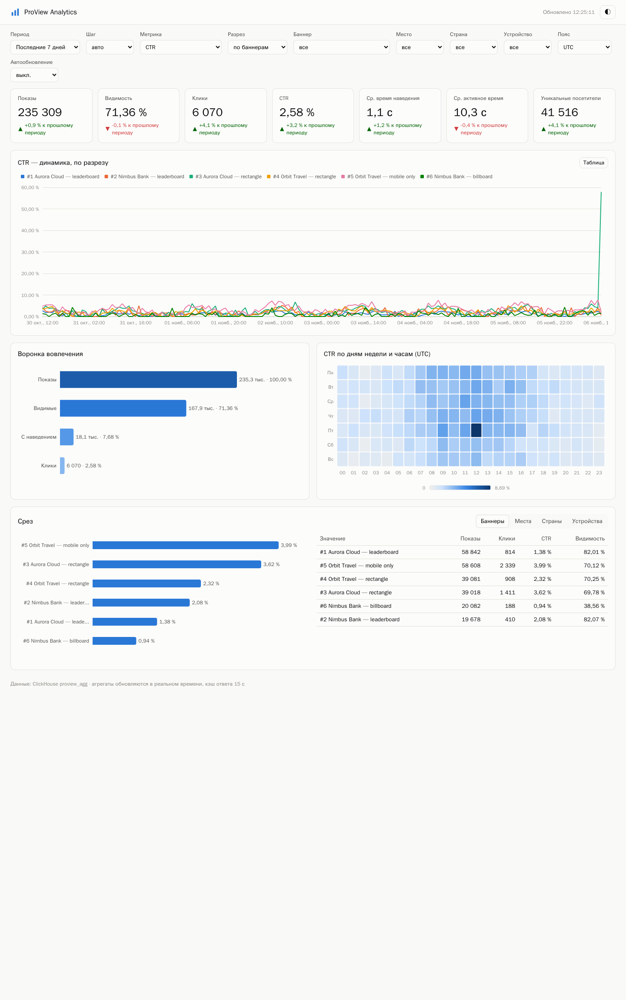
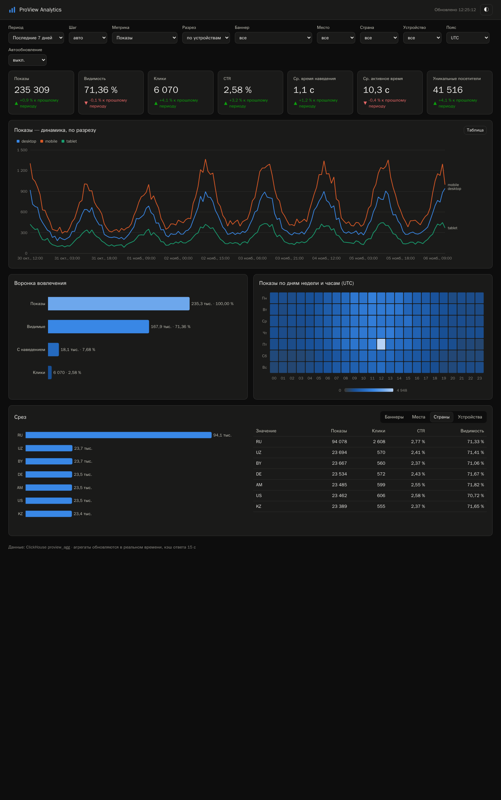
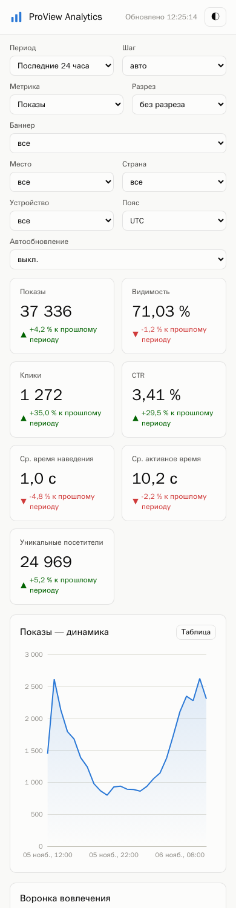
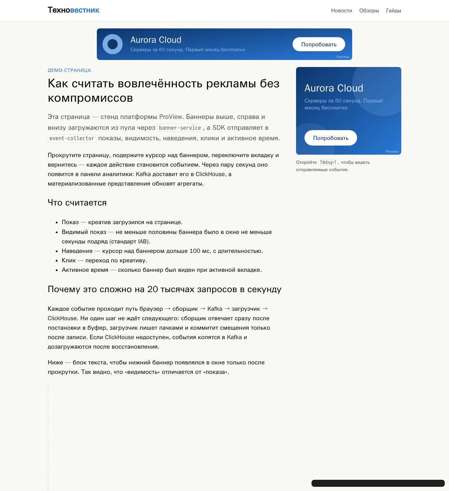

# ProView — UI/UX Specification

> BMAD Method · артефакт UX Expert · версия 1.0 · 2026-11-06

## 1. Пользователь и задачи

Основной пользователь — **менеджер рекламы**, потребитель среза. Его вопросы:

1. Как идут дела за период по сравнению с прошлым? Ответ дают KPI с дельтой.
2. Когда и где меняется метрика? Ответ — динамика с разрезом.
3. Где теряется внимание? Ответ — воронка показ → видимость → наведение → клик.
4. В какие часы и дни реклама работает лучше? Ответ — тепловая карта.
5. Какие креативы, места, страны и устройства лучше? Ответ — срез с таблицей.
6. Как поделиться видом с коллегой? Ссылкой: состояние хранится в URL.

## 2. Структура страницы

```
┌ Шапка: логотип · статус обновления · переключатель темы ───────────────────────┐
├ Фильтры (одна строка, переносится): Период · Шаг · Метрика · Разрез · Баннер ·   │
│   Место · Страна · Устройство · Пояс · Автообновление                            │
├ KPI ×7: Показы · Видимость · Клики · CTR · Ср. наведение · Ср. активное · Уник.  │
├ Динамика выбранной метрики (линии по разрезу, легенда, перекрестие) [Таблица]   │
├ Воронка вовлечения            │ Тепловая карта день × час (в поясе)            │
├ Срез [Баннеры|Места|Страны|Устройства]: горизонтальные бары │ таблица метрик   │
└ Подвал: источник данных, кэш ──────────────────────────────────────────────────┘
```

## 3. Правила визуализации

| Правило | Реализация |
|---|---|
| Форма по задаче данных | время → линия; часть пути → воронка (бары по убыванию); день × час → тепловая карта; сравнение категорий → горизонтальные бары, отсортированные по значению |
| Категориальные цвета в фиксированном порядке | 8 слотов палитры, проверенной на различимость при нарушениях цветовосприятия. 9-я и далее серии не получают новый цвет: запрос `top=8` |
| Цвет следует за сущностью, а не за рангом | `SlotAssigner`: баннер сохраняет цвет при смене фильтров (unit-тест) |
| Последовательная шкала — один тон | тепловая карта: синяя рампа от светлого к тёмному, в тёмной теме свои шаги |
| Одна ось Y | метрики разного масштаба не совмещаются, метрика выбирается фильтром |
| Не только цветом | у дельт KPI стрелка ▲▼ и текст «к прошлому периоду». Легенда при ≥ 2 сериях, подписи концов линий при ≤ 4 |
| Табличная альтернатива | кнопка «Таблица» у динамики, таблица рядом со срезом |
| Подсказки | перекрестие и тултип у линий, тултип у баров и ячеек |
| Тёмная тема | отдельно подобранные шаги палитры. Учитывается `prefers-color-scheme`, ручной выбор запоминается |

## 4. Адаптивность и доступность

- От 1440 px до 390 px: KPI-сетка `auto-fill`, две колонки становятся одной, фильтры переносятся, отступы 16 px.
- Текст графиков только в нейтральных цветах интерфейса, не в цвете серии.
- `role="img"` и `aria-label` у контейнеров графиков, `aria-live` у статуса, `aria-selected` у вкладок.
- Ошибки API показываются текстом в статусе. Пустой период выводит «Нет данных за выбранный период».

## 5. Проверка вёрстки

Скриншоты сняты headless Chromium на 14 днях синтетических данных (`proview-deploy/tools/datagen`) и живом трафике.

| Светлая, CTR по баннерам, 7 дней | Тёмная, показы по устройствам, срез по странам |
|---|---|
|  |  |

| Мобильная, 390 px | Демо-сайт с баннерами |
|---|---|
|  |  |

Найдено и исправлено при проверке:
- обрезанная подпись воронки;
- отсутствие подписей шкалы тепловой карты;
- последний столбец таблицы среза не помещался.

## 6. SDK на странице площадки

Место размечается `<div data-proview-placement="…">`. Пока баннер не загружен, место держит размер, чтобы не было сдвига макета (CLS). При no-fill (204) или ошибке место скрывается. Ссылка открывается с `rel="noopener sponsored"`, у изображения есть `alt`, на креативе стоит подпись «Реклама».
